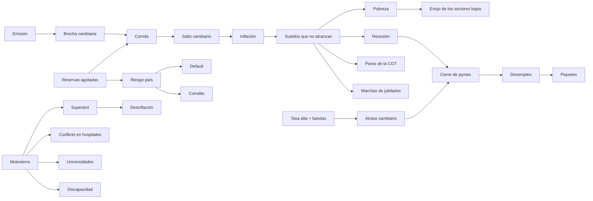

# Argentina: Gobernala — mod para Democracy 4

Agrega la **República Argentina** como país jugable, con dos escenarios y su propia economía política: inflación inercial, cepo y bandas cambiarias, retenciones, el FMI y el swap con Estados Unidos, motosierra y superávit, Vaca Muerta, piquetes, la CGT, los vetos y la grieta. Textos completos en **español e inglés**.

**Descarga directa:** [argentina_gobernala.zip](argentina_gobernala.zip)

## Dos escenarios

| | Argentina (diciembre de 2023) | Argentina 2026 (después del ajuste) |
|---|---|---|
| Situación inicial | Cepo total, emisión, reservas negativas, inflación de tres dígitos | Bandas cambiarias, superávit, inflación del 2 % mensual, reforma laboral aprobada |
| Crisis activas al arrancar | Brecha, reservas agotadas, riesgo país, salto cambiario, sueldos que no alcanzan, recesión, crisis energética, piquetes, grieta | Atraso cambiario, cierre de pymes, hospitales, marchas de jubilados, paros de la CGT, Congreso en contra, grieta |
| Al borde | Corrida, corralito, default | Discapacidad, universidades, pérdida del poder adquisitivo |
| Dificultad | 5 | 4 |

## Qué trae

| | Cantidad | Ejemplos |
|---|---|---|
| Políticas exclusivas | 50 | Cepo, bandas cambiarias, tasa del BCRA, emisión, retenciones, impuesto PAIS, FMI, alineamiento con EE.UU., motosierra, déficit cero, privatizaciones, desregulación, facultades delegadas, RIGI, Vaca Muerta, litio, inocencia fiscal, blanqueo, Ganancias, movilidad jubilatoria, moratoria, discapacidad, hospitales nacionales, ANMAT, AUH y Tarjeta Alimentar, planes sociales, protocolo antipiquetes, reforma laboral, PASO, imputabilidad, ley de glaciares, Hidrovía, Malvinas, dolarización… |
| Situaciones exclusivas | 28 | Brecha, reservas agotadas, riesgo país, corrida, salto cambiario, corralito, default, sueldos que no alcanzan, recesión, atraso cambiario, cierre de pymes, desempleo, piquetes, paros de la CGT, conflicto en hospitales, crisis de discapacidad, universidades, marchas de jubilados, Congreso en contra, escándalos, crisis energética, grieta; y a favor: desinflación, superávit, inversiones, boom energético, cosecha récord, estabilidad |
| Eventos con imagen | 27 | Campeones del mundo, escándalo cripto presidencial, audios de coimas, fentanilo contaminado, temporal en el sur bonaerense, muerte del Papa, rescate del Tesoro de EE.UU., dengue, falta de gas, paro de controladores, caen los homicidios en Rosario, mejora la nota de la deuda, cierra una fábrica emblemática… |
| Dilemas | 29 | Vetos a discapacidad y universidades, paro en el hospital pediátrico, condiciones del swap, el dólar toca el techo de la banda, privatizar la aerolínea, suspender las PASO, imputabilidad, glaciares, dólares del colchón, la CGT ofrece negociar, los industriales piden frenar importaciones, FMI, paritarias, lockout del campo, fondos buitre… |
| Rasgos estructurales | 6 | Inercia inflacionaria, evasión, corrupción, grieta, fuga de cerebros, economía informal |
| Enlaces causales argentinos | 12 | Ver "Efecto dominó" |

## Efecto dominó: todo se encadena

Las decisiones no afectan a una sola cosa. En Argentina, el mod refuerza las cadenas de transmisión del juego con **12 enlaces causales propios** y hace que **unas crisis desencadenen otras**:



Ejemplos:
- Un **peso débil** sube la **inflación**. La inflación sube la **pobreza** y enoja a los **sectores bajos, jubilados y sindicatos**. La pobreza sube el **delito**.
- Las **reservas agotadas** pueden desencadenar hasta **16 crisis** distintas: corrida, salto cambiario, recesión, pymes, desempleo, piquetes, default, corralito…
- La **motosierra** baja la inflación y genera **superávit**, que calma el **riesgo país**. Pero también enciende los conflictos en **hospitales, universidades y discapacidad**.
- Un **peso fuerte** abarata los viajes (contenta a la **clase media**), pero castiga al **campo** y al **turismo** y trae **importaciones** que cierran **pymes**.

## Instalación

1. Descomprimí `argentina_gobernala.zip`.
2. Copiá la carpeta `argentina_gobernala` a la carpeta de mods del juego:
   - Windows: `Documentos\My Games\democracy4\mods\`
   - Mac/Linux: la carpeta `democracy4/mods` dentro de tus documentos del juego
3. Abrí Democracy 4, entrá a **Mods** y activá **Argentina: Gobernala**.
4. Empezá una partida nueva y elegí **República Argentina** o **Argentina 2026**.

Es compatible con *D4 Overhaul & Expansion*: usa nombres, prerrequisitos e identificadores propios (`argentina`, `argentina2026`, `_prereq_argentina_gb`, prefijo `AR_`).

## Lista de pruebas (primera vez en el juego)

El mod se generó y validó automáticamente, pero **todavía no se probó dentro de Democracy 4**. Revisá, de lo más a lo menos importante:

1. **¿Arranca el juego con el mod activado?** Si no, el error suele indicar el archivo y la fila.
2. **¿Aparecen los dos países**, con bandera, mapa y descripción?
3. **¿Aparecen las 50 políticas**, con íconos y con las etiquetas de los deslizadores?
4. **¿Las políticas, situaciones, eventos y dilemas argentinos NO aparecen con otro país?**
5. **Moneda y cifras:** el país usa dólares (US$). Revisá que el PBI, la deuda y el presupuesto se vean razonables.
6. **Situaciones al arrancar:** deberían coincidir más o menos con la tabla de escenarios.
7. **Eventos y dilemas:** que aparezcan en los dos escenarios, con imagen y texto.

Puntos del formato que no pude confirmar con la documentación oficial:
- **Eventos y dilemas exclusivos de Argentina.** No usan `country_specific` (admitiría un solo país y dejaría afuera el escenario 2026). En su lugar, todas sus causas son políticas o situaciones argentinas, y el azar está atado a "La grieta", que sólo existe en Argentina. Si alguno aparece con otro país, avisame.
- **Eventos y dilemas que afectan situaciones del mod** (por ejemplo, `AR_ReservasAgotadas`).
- **Enlaces causales entre valores distintos** dentro de los overrides de un país. El formato es el mismo que usan los overrides globales de otros mods.

Si algo falla, pasame el mensaje de error o una captura y lo corrijo en el generador.

## Subirlo a Steam Workshop

Desde el menú **Mods** del juego, elegí el mod y usá la opción para subirlo al Workshop. Como imagen de portada usá `preview.jpg`, dentro de la carpeta del mod.

## Cómo se genera

El contenido está como datos en `build/content.py` (base) y `build/content_ext.py` (ampliación 2024-2026, cadenas y escenario 2026).

```bash
# una sola vez: herramientas de gráficos
npm i --no-save @tabler/icons@3.19.0 world-atlas@2.0.2 topojson-client@3.1.0
pip install potracer pillow numpy

# gráficos (íconos, bandera, mapa, imágenes de eventos, portada)
python3 -c "import sys,json; sys.path.insert(0,'build'); import content as C; json.dump({'policies':[{'name':p['name'],'icon':p['icon']} for p in C.POLICIES],'situations':[{'name':s['name'],'icon':s['icon']} for s in C.SITUATIONS],'events':[{'name':e['name'],'scene':e['scene']} for e in C.EVENTS],'dilemmas':len(C.DILEMMAS)},open('.tmp/content.json','w'))"
node build/assets.js .tmp && python3 build/trace_icons.py .tmp

# archivos del mod, validación y simulación de balance
python3 build/build.py && python3 build/validate.py && python3 build/simulate.py
```

- `validate.py` revisa:
  - que todo nombre usado exista;
  - que las fórmulas sean válidas y den valores razonables;
  - que cada situación pueda activarse;
  - que ningún evento ni dilema dependa de valores de otros países;
  - que no falten traducciones, íconos ni imágenes.

  Además mide el efecto dominó y avisa si hay realimentaciones fuertes.
- `simulate.py` aproxima qué crisis quedan activas al arrancar cada escenario, para calibrar el balance sin abrir el juego.

## Fuentes de los hechos 2024-2026

Datos y hechos tomados de prensa argentina e internacional, entre otros:
- Inflación, dólar, bandas, reservas y riesgo país a noviembre de 2026: Infobae (REM del BCRA), Valor Local, Impacto Castex.
- Salida del cepo, FMI, swap con EE.UU. y elecciones de 2025: Real Instituto Elcano, Infobae, CNN en Español.
- Reforma laboral de 2026: Bloomberg, La Nación, SWI swissinfo.ch.
- Vetos y conflictos de 2025: Infobae, La Nación, Buenos Aires Times.
- Casos $LIBRA, ANDIS y fentanilo: El Sol, France 24, Expansión.
- Pobreza, actividad y pymes en 2026: Perfil (INDEC), MDZ, El Ancasti.
- Incendios en la Patagonia en 2026: Mongabay, Agrofy.
- Privatizaciones y PASO: El Cronista, Infobae, Perfil.

Los personajes de dilemas y eventos son cargos genéricos ("la ministra de Economía", "el jefe de Gabinete"): no se nombra a personas reales.

## Créditos

- Íconos: [Tabler Icons](https://tabler.io/icons) (licencia MIT), vectorizados como formas rellenas.
- Mapa: [world-atlas](https://github.com/topojson/world-atlas), a partir de Natural Earth (dominio público). Incluye las islas Malvinas, como la cartografía oficial argentina.
- Imágenes de eventos: ilustraciones de [Gobernala](https://gobernala.vercel.app).
- El formato de los archivos se aprendió estudiando mods públicos (*The Culture War*, *D4 Overhaul & Expansion*). No se copió contenido de ellos.
