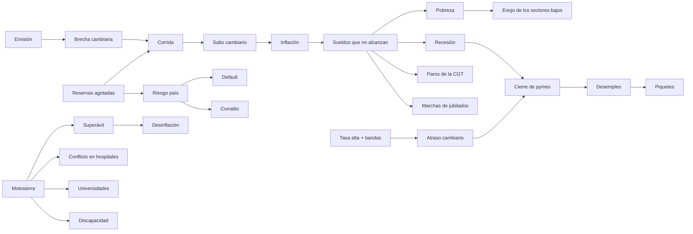

# Argentina: Gobernala — mod para Democracy 4

Agrega la **República Argentina** como país jugable, desde el cambio de gobierno del **10 de diciembre de 2023**, con el contexto internacional y su propia economía política: inflación inercial, cepo y bandas cambiarias, retenciones, el FMI y el swap con Estados Unidos, motosierra y superávit, Vaca Muerta, piquetes, la CGT, los vetos y la grieta. Textos completos en **español e inglés**.

**Descarga directa:** [argentina_gobernala.zip](argentina_gobernala.zip)

## Cómo arranca

Una sola Argentina, que empieza el 10 de diciembre de 2023:
- **Lo que heredás:** cepo total, emisión para financiar el déficit, retenciones del 26 %, subsidios amplios, reservas negativas, inflación del 25 % mensual y un Congreso en minoría. Dificultad 5.
- **Crisis activas al arrancar:** brecha cambiaria, reservas agotadas, riesgo país, salto cambiario, sueldos que no alcanzan, recesión, crisis energética, piquetes y la grieta.
- **Al borde:** corrida, corralito y default.

Todo lo que pasó después (bandas cambiarias, motosierra, superávit, swap con EE.UU., reforma laboral, vetos, escándalos, Ormuz, la Fed…) está disponible como **políticas que podés tomar o no**, y como **eventos, dilemas y crisis que pueden aparecer** según lo que hagas. Si aplicás las políticas que se tomaron en la realidad, el modelo llega a algo parecido a la Argentina de 2026: desinflación, superávit e inversiones, pero con atraso cambiario, cierre de pymes, conflicto en hospitales y marchas de jubilados.

## Qué trae

| | Cantidad | Ejemplos |
|---|---|---|
| Políticas | 59 | Cepo, bandas cambiarias, tasa del BCRA, emisión, retenciones, impuesto PAIS, FMI, alineamiento con EE.UU., motosierra, déficit cero, privatizaciones, desregulación, facultades delegadas, RIGI, Vaca Muerta, litio, inocencia fiscal, blanqueo, Ganancias, movilidad jubilatoria, moratoria, discapacidad, hospitales nacionales, ANMAT, AUH y Tarjeta Alimentar, planes sociales, protocolo antipiquetes, reforma laboral, PASO, imputabilidad, ley de glaciares, Hidrovía, Malvinas, dolarización; y exterior: Ucrania, Israel, China, BRICS, OCDE, reequipamiento militar, misiones de paz, Antártida, migración |
| Situaciones | 38 | Brecha, reservas agotadas, riesgo país, corrida, salto cambiario, corralito, default, sueldos que no alcanzan, recesión, atraso cambiario, cierre de pymes, desempleo, piquetes, paros de la CGT, conflicto en hospitales, crisis de discapacidad, universidades, marchas de jubilados, Congreso en contra, escándalos, crisis energética, grieta; y a favor: desinflación, superávit, inversiones, boom energético, cosecha récord, estabilidad. Internacionales: guerra en Europa, crisis en Medio Oriente, guerra comercial, tasas altas en EE.UU., crisis en Brasil, superciclo de materias primas, pandemia, crisis financiera global, ola migratoria, acuerdo con la UE en vigor |
| Eventos con imagen | 38 | Campeones del mundo, escándalo cripto presidencial, audios de coimas, fentanilo contaminado, temporal en el sur bonaerense, muerte del Papa, rescate del Tesoro de EE.UU., dengue, falta de gas, paro de controladores, caen los homicidios en Rosario, mejora la nota de la deuda, cierra una fábrica emblemática; y del mundo: estalla una guerra en Europa, se cierra el estrecho de Ormuz, aranceles globales, la Fed sube tasas, Brasil devalúa, la soja vuela, pandemia, derrumbe en Wall Street, éxodo venezolano, entra en vigor el acuerdo con la UE, China compra soja récord |
| Dilemas | 38 | Vetos a discapacidad y universidades, paro en el hospital pediátrico, condiciones del swap, el dólar toca el techo de la banda, privatizar la aerolínea, suspender las PASO, imputabilidad, glaciares, dólares del colchón, la CGT ofrece negociar, los industriales piden frenar importaciones, FMI, paritarias, lockout del campo, fondos buitre; y del mundo: armas para Ucrania, votación en la ONU sobre Medio Oriente, embajada en Jerusalén, refugiados, estación espacial china en Neuquén, 5G, moneda común con Brasil, aviones de combate, cláusulas ambientales de Europa |
| Rasgos estructurales | 6 | Inercia inflacionaria, evasión, corrupción, grieta, fuga de cerebros, economía informal |
| Enlaces causales argentinos | 12 | Ver "Efecto dominó" |
| Conexiones con el juego base | 47 | Ver "Lo que ya trae el juego" |

El detalle de cada política, situación, evento y dilema, con sus efectos, está en el **[catálogo completo](CATALOGO.md)**.

## El mundo también juega

Las crisis internacionales las dispara un evento (por ejemplo, "se cierra el estrecho de Ormuz") y se apagan solas a medida que el impulso decae. Mientras duran, se encadenan con la economía argentina:
- **Guerra en Medio Oriente o en Europa:** petróleo y granos caros. Sube la inflación importada (el sueldo no alcanza), pero se dispara el **boom energético** de Vaca Muerta y la cosecha vale más.
- **La Fed sube tasas o hay crisis en Wall Street:** el **riesgo país** rebota, las reservas sufren y puede haber **corrida** y **salto cambiario**.
- **Crisis en Brasil:** caen las exportaciones industriales, cierran **pymes** y se acerca la **recesión**.
- **Pandemia:** recesión y **colapso de los hospitales**.
- **Superciclo de materias primas o acuerdo con la UE:** entran dólares, mejora el campo y llegan **inversiones**.

Tu política exterior también cuenta: alinearte con EE.UU. te expone a la guerra comercial; acercarte a China trae compras de soja; la postura frente a Israel afecta el riesgo de terrorismo.

## Lo que ya trae el juego

Democracy 4 ya tiene sus propias políticas: jubilaciones, salario mínimo, leyes laborales, aranceles, salud pública, becas universitarias, control de capitales, emisión monetaria, IVA, etc. En Argentina, **esas políticas también mueven las crisis argentinas**, así que da lo mismo por dónde tomes la decisión:
- Bajar las **jubilaciones** o subir la **edad jubilatoria** del juego alimenta las **marchas de jubilados**.
- Bajar el **salario mínimo**, las **jubilaciones** o las **asignaciones familiares**, o subir el **IVA**, alimenta "el sueldo no alcanza".
- Bajar los **aranceles** o subir las **cargas sociales** alimenta el **cierre de pymes**; la **ayuda a pymes** lo frena.
- Flexibilizar las **leyes laborales** o bajar el **salario mínimo** alimenta los **paros de la CGT**.
- El **control de capitales** y la **emisión** del juego agrandan la **brecha cambiaria**, igual que el cepo y la emisión del mod.
- Bajar la **salud pública**, las **becas universitarias** o la **pensión por discapacidad** enciende los conflictos en **hospitales, universidades y discapacidad**.
- La **independencia judicial** baja el **riesgo país** y los **escándalos de corrupción**, y atrae **inversiones**.
- Las **situaciones del juego** también empujan a sus equivalentes argentinas: la **hiperinflación** y la **inflación alta** del juego alimentan el salto cambiario y "el sueldo no alcanza"; la **huelga general**, el **paro de médicos** y el **paro docente** alimentan los paros de la CGT y los conflictos en hospitales y universidades; el **éxodo de empresas** frena las inversiones.

Los nombres internos se comprobaron contra partidas guardadas reales de Democracy 4 (versión 1.65).

Al arrancar, el país tiene activas las políticas del juego que existían en 2023 (aranceles altos, aerolínea, trenes y petrolera estatales). El control de capitales y la emisión del juego arrancan apagados, porque el mod los representa con más detalle (cepo y asistencia del BCRA al Tesoro).

## Efecto dominó: todo se encadena

Las decisiones no afectan a una sola cosa. En Argentina, el mod refuerza las cadenas de transmisión del juego con **12 enlaces causales propios** y hace que **unas crisis desencadenen otras**:



Ejemplos:
- Un **peso débil** sube la **inflación**. La inflación sube la **pobreza** y enoja a los **sectores bajos, jubilados y sindicatos**. La pobreza sube el **delito**.
- Las **reservas agotadas** pueden desencadenar hasta **16 crisis** distintas: corrida, salto cambiario, recesión, pymes, desempleo, piquetes, default, corralito…
- La **motosierra** baja la inflación y genera **superávit**, que calma el **riesgo país**. Pero también enciende los conflictos en **hospitales, universidades y discapacidad**.
- Un **peso fuerte** abarata los viajes (contenta a la **clase media**), pero castiga al **campo** y al **turismo** y trae **importaciones** que cierran **pymes**.

## Instalación

1. Descomprimí `argentina_gobernala.zip`.
2. Copiá la carpeta `argentina_gobernala` a la carpeta de mods del juego:
   - Windows: `Documentos\My Games\democracy4\mods\`
   - Mac/Linux: la carpeta `democracy4/mods` dentro de tus documentos del juego
3. Abrí Democracy 4, entrá a **Mods** y activá **Argentina: Gobernala**.
4. Empezá una partida nueva y elegí **República Argentina (diciembre de 2023)**.

Es compatible con *D4 Overhaul & Expansion*: usa nombres, prerrequisitos e identificadores propios (`argentina`, `_prereq_argentina_gb`, prefijo `AR_`).

El mod está pensado para jugar con Argentina: las políticas y situaciones argentinas sólo aparecen en Argentina, pero algunos eventos y dilemas pueden aparecer si jugás con otro país.

## Lista de pruebas (primera vez en el juego)

El mod se generó y validó automáticamente, pero **todavía no se probó dentro de Democracy 4**. Revisá, de lo más a lo menos importante:

1. **¿Arranca el juego con el mod activado?** Si no, el error suele indicar el archivo y la fila.
2. **¿Aparece "República Argentina (diciembre de 2023)"**, con bandera, mapa y descripción?
3. **¿Aparecen las 59 políticas**, con íconos y con las etiquetas de los deslizadores?
4. **Las políticas del juego (jubilaciones, aranceles, salario mínimo…) ¿mueven las situaciones argentinas?**
5. **Moneda y cifras:** el país usa dólares (US$). Revisá que el PBI, la deuda y el presupuesto se vean razonables.
6. **Situaciones al arrancar:** deberían coincidir más o menos con "Cómo arranca".
7. **Eventos y dilemas:** que aparezcan con imagen y texto.

Puntos del formato que no pude confirmar con la documentación oficial:
- **Eventos y dilemas que afectan situaciones del mod** con `CreateGrudge` (por ejemplo, "se cierra Ormuz" dispara `AR_CrisisMedioOriente`). Es la forma en que arrancan las crisis internacionales. Cada evento también aplica su golpe directo sobre la economía, así que el shock se siente igual aunque esto no funcionara.
- **Enlaces causales entre valores distintos** dentro de los overrides de un país. El formato es el mismo que usan los overrides globales de otros mods.

Si algo falla, pasame el mensaje de error o una captura y lo corrijo en el generador.

## Subirlo a Steam Workshop

Desde el menú **Mods** del juego, elegí el mod y usá la opción para subirlo al Workshop. Como imagen de portada usá `preview.jpg`, dentro de la carpeta del mod.

## Cómo se genera

El contenido está como datos, ordenado por tema:
- `build/content.py`: el país, las políticas y crisis originales.
- `build/content_ext.py`: ampliación 2024-2026, cadenas y enlaces causales.
- `build/content_intl.py`: el mundo (política exterior, crisis globales, eventos y dilemas internacionales).
- `build/content_base.py`: conexiones con las políticas que ya trae Democracy 4.

```bash
# una sola vez: herramientas de gráficos
npm i --no-save @tabler/icons@3.19.0 world-atlas@2.0.2 topojson-client@3.1.0
pip install potracer pillow numpy

# gráficos (íconos, bandera, mapa, imágenes de eventos, portada)
python3 -c "import sys,json; sys.path.insert(0,'build'); import content as C; json.dump({'policies':[{'name':p['name'],'icon':p['icon']} for p in C.POLICIES],'situations':[{'name':s['name'],'icon':s['icon']} for s in C.SITUATIONS],'events':[{'name':e['name'],'scene':e['scene']} for e in C.EVENTS],'dilemmas':len(C.DILEMMAS)},open('.tmp/content.json','w'))"
node build/assets.js .tmp && python3 build/trace_icons.py .tmp

# archivos del mod, validación y simulación de balance
python3 build/build.py && python3 build/validate.py && python3 build/simulate.py && python3 build/catalog.py
```

- `validate.py` revisa:
  - que todo nombre usado exista;
  - que las fórmulas sean válidas y den valores razonables;
  - que cada situación pueda activarse;
  - que cada crisis internacional tenga un evento capaz de dispararla;
  - que no falten traducciones, íconos ni imágenes.

  Además mide el efecto dominó y avisa si hay realimentaciones fuertes.
- `simulate.py` aproxima qué crisis quedan activas al arrancar y con las políticas de 2024-2026, para calibrar el balance sin abrir el juego.
- `catalog.py` genera [CATALOGO.md](CATALOGO.md) con todo el contenido en castellano.

## Fuentes de los hechos 2024-2026

Datos y hechos tomados de prensa argentina e internacional, entre otros:
- Inflación, dólar, bandas, reservas y riesgo país a noviembre de 2026: Infobae (REM del BCRA), Valor Local, Impacto Castex.
- Salida del cepo, FMI, swap con EE.UU. y elecciones de 2025: Real Instituto Elcano, Infobae, CNN en Español.
- Reforma laboral de 2026: Bloomberg, La Nación, SWI swissinfo.ch.
- Vetos y conflictos de 2025: Infobae, La Nación, Buenos Aires Times.
- Casos $LIBRA, ANDIS y fentanilo: El Sol, France 24, Expansión.
- Pobreza, actividad y pymes en 2026: Perfil (INDEC), MDZ, El Ancasti.
- Incendios en la Patagonia en 2026: Mongabay, Agrofy.
- Contexto internacional en noviembre de 2026 (Ormuz, petróleo, tasas de la Fed, riesgo país, récord de producción de petróleo): Infobae, Rosario3, iProfesional, Cohen.
- Acuerdo Mercosur-UE (firmado el 17 de enero de 2026): Cancillería argentina.
- Privatizaciones y PASO: El Cronista, Infobae, Perfil.

Los personajes de dilemas y eventos son cargos genéricos ("la ministra de Economía", "el jefe de Gabinete"): no se nombra a personas reales.

## Créditos

- Íconos: [Tabler Icons](https://tabler.io/icons) (licencia MIT), vectorizados como formas rellenas.
- Mapa: [world-atlas](https://github.com/topojson/world-atlas), a partir de Natural Earth (dominio público). Incluye las islas Malvinas, como la cartografía oficial argentina.
- Imágenes de eventos: ilustraciones de [Gobernala](https://gobernala.vercel.app).
- El formato de los archivos se aprendió estudiando mods públicos (*The Culture War*, *D4 Overhaul & Expansion*). No se copió contenido de ellos.
