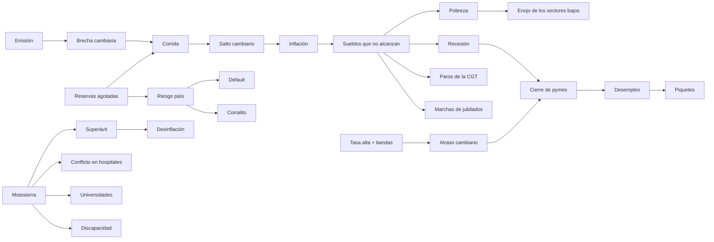

# Argentina: Gobernala — mod para Democracy 4

Agrega la **República Argentina** como país jugable, desde el cambio de gobierno del **10 de diciembre de 2023**, con el contexto internacional y su propia economía política: inflación inercial, cepo (con el control de capitales del juego) y bandas cambiarias, retenciones, el FMI y el swap con Estados Unidos, motosierra y superávit, Vaca Muerta, piquetes, la CGT, los vetos y la grieta. Textos completos en **español e inglés**.

**Descarga directa:** [argentina_gobernala.zip](argentina_gobernala.zip)

## Cómo arranca

Una sola Argentina, que empieza el 10 de diciembre de 2023:
- **Lo que heredás:** cepo total, emisión para financiar el déficit, retenciones del 26 %, subsidios amplios, reservas negativas, inflación del 25 % mensual y un Congreso en minoría. Dificultad 5.
- **Crisis activas al arrancar:** brecha cambiaria, reservas agotadas, riesgo país, salto cambiario, sueldos que no alcanzan, recesión, crisis energética, piquetes y la grieta.
- **Al borde:** corrida, corralito y default.

Todo lo que pasó después (bandas cambiarias, motosierra, superávit, swap con EE.UU., reforma laboral, vetos, escándalos, Ormuz, la Fed…) está disponible como **políticas que podés tomar o no**, y como **eventos, dilemas y crisis que pueden aparecer** según lo que hagas. Si aplicás las políticas que se tomaron en la realidad, el modelo llega a algo parecido a la Argentina de 2026: desinflación, superávit e inversiones, pero con atraso cambiario, cierre de pymes, conflicto en hospitales y marchas de jubilados.

## Qué trae

| | Cantidad | Ejemplos |
|---|---|---|
| Políticas propias | 54 | Bandas cambiarias, tasa del BCRA, retenciones, impuesto PAIS, FMI, alineamiento con EE.UU., motosierra, déficit cero, desregulación, facultades delegadas, cierre de organismos, litio, inocencia fiscal, blanqueo, monotributo, moratoria, planes sociales, bonos, subsidios a la luz y el gas, salarios estatales, ANMAT, protocolo antipiquetes, aportes sindicales, PASO, Ficha Limpia, imputabilidad, ley de glaciares, Hidrovía, Malvinas, dolarización; y exterior: Ucrania, Israel, China, BRICS, OCDE, misiones de paz, Antártida |
| Políticas del juego con efectos argentinos | 20 | El cepo es el control de capitales del juego, la emisión es su emisión monetaria, la AUH son las asignaciones familiares, el CONICET es el financiamiento científico, etc. Ver "Sin políticas repetidas" |
| Situaciones | 38 | Brecha, reservas agotadas, riesgo país, corrida, salto cambiario, corralito, default, sueldos que no alcanzan, recesión, atraso cambiario, cierre de pymes, desempleo, piquetes, paros de la CGT, conflicto en hospitales, crisis de discapacidad, universidades, marchas de jubilados, Congreso en contra, escándalos, crisis energética, grieta; y a favor: desinflación, superávit, inversiones, boom energético, cosecha récord, estabilidad. Internacionales: guerra en Europa, crisis en Medio Oriente, guerra comercial, tasas altas en EE.UU., crisis en Brasil, superciclo de materias primas, pandemia, crisis financiera global, ola migratoria, acuerdo con la UE en vigor |
| Eventos con imagen | 38 | Campeones del mundo, escándalo cripto presidencial, audios de coimas, fentanilo contaminado, temporal en el sur bonaerense, muerte del Papa, rescate del Tesoro de EE.UU., dengue, falta de gas, paro de controladores, caen los homicidios en Rosario, mejora la nota de la deuda, cierra una fábrica emblemática; y del mundo: estalla una guerra en Europa, se cierra el estrecho de Ormuz, aranceles globales, la Fed sube tasas, Brasil devalúa, la soja vuela, pandemia, derrumbe en Wall Street, éxodo venezolano, entra en vigor el acuerdo con la UE, China compra soja récord |
| Dilemas | 38 | Vetos a discapacidad y universidades, paro en el hospital pediátrico, condiciones del swap, el dólar toca el techo de la banda, privatizar la aerolínea, suspender las PASO, imputabilidad, glaciares, dólares del colchón, la CGT ofrece negociar, los industriales piden frenar importaciones, FMI, paritarias, lockout del campo, fondos buitre; y del mundo: armas para Ucrania, votación en la ONU sobre Medio Oriente, embajada en Jerusalén, refugiados, estación espacial china en Neuquén, 5G, moneda común con Brasil, aviones de combate, cláusulas ambientales de Europa |
| Rasgos estructurales | 6 | Inercia inflacionaria, evasión, corrupción, grieta, fuga de cerebros, economía informal |
| Enlaces causales argentinos | 11 | Ver "Efecto dominó" |
| Otras conexiones con el juego | 47 | Ver "Lo que ya trae el juego" |

El detalle de cada política, situación, evento y dilema, con sus efectos, está en el **[catálogo completo](CATALOGO.md)**.

## El mundo también juega

Las crisis internacionales las dispara un evento (por ejemplo, "se cierra el estrecho de Ormuz") y se apagan solas a medida que el impulso decae. Mientras duran, se encadenan con la economía argentina:
- **Guerra en Medio Oriente o en Europa:** petróleo y granos caros. Sube la inflación importada (el sueldo no alcanza), pero se dispara el **boom energético** de Vaca Muerta y la cosecha vale más.
- **La Fed sube tasas o hay crisis en Wall Street:** el **riesgo país** rebota, las reservas sufren y puede haber **corrida** y **salto cambiario**.
- **Crisis en Brasil:** caen las exportaciones industriales, cierran **pymes** y se acerca la **recesión**.
- **Pandemia:** recesión y **colapso de los hospitales**.
- **Superciclo de materias primas o acuerdo con la UE:** entran dólares, mejora el campo y llegan **inversiones**.

Tu política exterior también cuenta: alinearte con EE.UU. te expone a la guerra comercial; acercarte a China trae compras de soja; la postura frente a Israel afecta el riesgo de terrorismo.

## Lo que ya trae el juego

Democracy 4 ya tiene sus propias políticas: jubilaciones, salario mínimo, leyes laborales, aranceles, salud pública, becas universitarias, control de capitales, emisión monetaria, IVA, etc. En Argentina, **esas políticas también mueven las crisis argentinas**, así que da lo mismo por dónde tomes la decisión:
- Bajar las **jubilaciones** o subir la **edad jubilatoria** del juego alimenta las **marchas de jubilados**.
- Bajar el **salario mínimo**, las **jubilaciones** o las **asignaciones familiares**, o subir el **IVA**, alimenta "el sueldo no alcanza".
- Bajar los **aranceles** o subir las **cargas sociales** alimenta el **cierre de pymes**; la **ayuda a pymes** lo frena.
- Flexibilizar las **leyes laborales** o bajar el **salario mínimo** alimenta los **paros de la CGT**.
- El **control de capitales** (el cepo) y la **emisión** agrandan la **brecha cambiaria**.
- Bajar la **salud pública**, las **becas universitarias** o la **pensión por discapacidad** enciende los conflictos en **hospitales, universidades y discapacidad**.
- La **independencia judicial** baja el **riesgo país** y los **escándalos de corrupción**, y atrae **inversiones**.
- Las **situaciones del juego** también empujan a sus equivalentes argentinas: la **hiperinflación** del juego alimenta el salto cambiario y "el sueldo no alcanza"; la **huelga general**, el **paro de médicos** y el **paro docente** alimentan los paros de la CGT y los conflictos en hospitales y universidades; el **éxodo de empresas** frena las inversiones.

Los nombres internos se comprobaron contra partidas guardadas reales de Democracy 4 (versión 1.65).

Al arrancar, el país tiene activas las políticas del juego que existían en 2023 (aranceles altos, aerolínea, trenes y petrolera estatales, control de capitales al máximo, emisión, impuesto a la riqueza).

## Nombres argentinos

El mod también **renombra 30 políticas, 4 situaciones y 52 eventos del juego** para que se lean como en Argentina: el control de capitales es el **Cepo cambiario**, el impuesto sobre la renta es **Impuesto a las Ganancias**, el de ventas es el **IVA**, la nómina son las **Cargas sociales**, la aerolínea estatal es **Aerolíneas Argentinas**, los ferrocarriles son **Trenes Argentinos**, la energía estatal es **YPF**, el correo es **Correo Argentino**, los servicios de inteligencia son la **SIDE**, la huelga de profesores es el **Paro docente**, etc. Es sólo el texto (nombre y descripción, en castellano y en inglés): la mecánica sigue siendo la del juego más lo que le conecta el mod. Mientras el mod esté activo, esos nombres cambian también si jugás con otro país. La lista completa está en el [catálogo](CATALOGO.md).

También tienen versión argentina **52 eventos del juego**: el escándalo de cuentas offshore, el fraude en el Banco Central, el paro de estatales, las condenas por lesa humanidad, el terremoto en Cuyo, el derrame en la costa patagónica, la serie argentina que arrasa en el mundo, el unicornio que sale a la bolsa, gatillo fácil, el faltante de nafta, la Selección que se vuelve temprano del Mundial, un argentino al frente de la ONU, etc. Cada uno cuenta el mismo hecho que el original y tiene el mismo efecto; sólo cambia el relato. Quedaron afuera los que ya tienen un evento propio en el mod (sequía, Mundial ganado, incendios, pandemia, temporal, cierre de fábrica, guerra comercial, mejora de la nota de la deuda), para no tener dos iguales, y los que no aplican a Argentina (los de la realeza, o el de Malvinas, que el juego cuenta desde el lado británico).

## Otros programas: Unión por la Patria, el PRO y el Frente de Izquierda

El país arranca con lo que había en diciembre de 2023, pero se puede gobernar con otro programa. Además de las políticas que aplicó el gobierno que asumió, están las que propusieron o aplicaron los otros espacios, con sus consecuencias encadenadas a las crisis argentinas:

| Espacio | Políticas |
|---|---|
| Unión por la Patria | Dólares diferenciales (dólar soja), prohibición de despidos y doble indemnización, Compre Argentino, aporte solidario de las grandes fortunas, reforma judicial y ampliación de la Corte, ley de medios, expropiación de empresas estratégicas; y del juego con nombre argentino: Salario Básico Universal, Ley de Alquileres, Procrear, participación en las ganancias |
| PRO / Juntos por el Cambio | Bimonetarismo, independencia del Banco Central, Boleta Única de Papel, educación como servicio esencial, ley de reiterancia |
| Frente de Izquierda | Desconocer la deuda y romper con el FMI, nacionalización de la banca y del comercio exterior, reducción de la jornada laboral |

Por ejemplo: romper con el FMI empuja el default y el riesgo país; nacionalizar la banca dispara la corrida y el corralito; el bimonetarismo y la independencia del Banco Central ayudan a la desinflación; la prohibición de despidos frena el desempleo pero cierra pymes.

## Sin políticas repetidas

En otros mods de Argentina pasa que aparecen dos políticas para lo mismo (por ejemplo, "Universidad pública" y "Becas universitarias", las dos activas). Acá no: cuando el juego ya tiene una política equivalente, **se usa la del juego** y se le conectan todas las consecuencias argentinas. Sus íconos, costos y efectos generales son los del juego; lo argentino (crisis, eventos, dilemas) se suma encima.

| Lo argentino | Se maneja con la política del juego |
|---|---|
| Cepo cambiario | Control de capitales |
| Asistencia del BCRA al Tesoro | Emisión monetaria (flexibilización cuantitativa) |
| Movilidad jubilatoria | Jubilaciones estatales |
| AUH | Asignaciones familiares |
| Prestaciones por discapacidad | Pensión por discapacidad |
| Universidad pública | Becas universitarias |
| CONICET | Financiamiento científico |
| Hospitales nacionales (Garrahan) | Salud pública |
| Ganancias sobre salarios | Impuesto a la renta |
| Bienes Personales | Impuesto a la riqueza |
| RIGI | Beneficios a inversores extranjeros |
| Vaca Muerta | Subsidio a la perforación petrolera |
| Subsidios al transporte | Subsidios al colectivo |
| Obra pública nacional | Construcción de rutas |
| Reequipamiento militar | Gasto militar |
| Plan contra el narcotráfico | Lucha contra las drogas |
| Política migratoria | Controles fronterizos |
| Privatizaciones | Aerolínea estatal (bajarla = privatizar) |
| Reforma laboral | Leyes laborales (bajarlas = reforma) |
| Apertura comercial | Aranceles (bajarlos = abrir) |

Las políticas que quedan propias del mod son las que el juego no tiene: retenciones, impuesto PAIS, bandas cambiarias, tasa del BCRA, monotributo, moratoria, planes sociales, subsidios a las tarifas, Malvinas, etc.

## Balance probado en el juego

En la primera partida de prueba (Democracy 4 1.67) el país colapsaba en los turnos de preparación que simula el juego antes de empezar: PBI a cero, desempleo de 77 % y peso a cero. Se corrigió en `build/content_balance.py`: los golpes macro de las crisis argentinas van a la mitad (se suman entre sí y con las del juego), la inercia inflacionaria ya no empuja una espiral, se quitó el enlace dólar-precios que pisaba el del juego y el gasto inicial se parece más al presupuesto nacional real (escuelas y hospitales son sobre todo provinciales).

En la segunda partida de prueba el colapso seguía: en el primer turno de preparación el delito saltaba de 0,23 a 0,95 y la salud de 0,86 a 0,45 por la combinación de políticas del juego con que arrancaba el país. Ahora el país arranca con los niveles de políticas del juego de una partida argentina que sí funcionaba en Democracy 4, más los ajustes argentinos (cepo, universidad gratuita, CONICET, YPF), y con menos emisión inicial.

### Calibración con las fórmulas reales del juego

Con los archivos `data/simulation` de Democracy 4 (1.67) se armó un simulador (`build/d4sim.py`) que reproduce las ecuaciones del juego; comprobado contra partidas reales, predice el turno siguiente con un error medio de ~0,04 y reproduce el colapso que se veía en las partidas de prueba. Con él (`build/warmup.py`) se buscaron, dentro de rangos realistas, los niveles iniciales de las políticas que después de los turnos de preparación dejan a la Argentina cerca de los datos de diciembre de 2023:

| | Simulado al empezar | Objetivo (escala del juego) | Dato real |
|---|---|---|---|
| PBI | 0,46 | 0,40 | recesión, −1,6 % en 2023 |
| Desempleo | 0,42 | 0,40 | 5,7 % |
| Inflación | 0,73 | 0,72 | 211 % anual |
| Peso | 0,07 | 0,08 | brecha de más del 100 % |
| Pobreza | 0,62 | 0,58 | 41,7 % |
| Delito | 0,60 | 0,62 | alto, con Rosario como foco |
| Salud | 0,62 | 0,62 | |
| Igualdad | 0,47 | 0,45 | Gini ~0,45 |

Valores argentinos que salen de ahí: cepo fuerte, emisión alta, aranceles y licencias SIRA, IVA alto, Ganancias bajo (eliminado para casi todos los asalariados en septiembre de 2023), salario mínimo licuado, AUH y Tarjeta Alimentar, DNI obligatorio, policía armada, sin impuesto a la herencia nacional. Si después se aplican las políticas de 2024-2026, el modelo baja la inflación, aprecia el peso, hunde y después recupera el PBI, baja la pobreza y sube la confianza empresaria, como pasó.

Tercera partida de prueba: al empezar el ajuste el PBI se iba a cero. El simulador lo reprodujo y mostró dos causas: la deuda inicial (con 390.000 la "deuda efectiva" del juego quedaba alrededor de 1,3, lo que deja la confianza empresaria y la estabilidad en cero y dispara la crisis de deuda) y la huelga general del juego (−0,3 a −0,5 de PBI por turno mientras dura). Ahora la deuda inicial cuenta sólo la deuda con privados y organismos (240.000; la intra-sector público con el BCRA y la ANSES no presiona igual) y, sólo en Argentina, la huelga general cuesta lo que un paro real. Con las mismas jugadas de esa partida, el simulador da recesión al principio, desinflación y recuperación después.

Cuarta partida de prueba: la trayectoria ya se parece a la real (recesión al empezar el ajuste, después desinflación, superávit y recuperación; la confianza empresaria pasó de 0 a 0,76). Pero en tres partidas no había salido ni un evento argentino: en el juego un evento ocurre cuando su valor llega a 1, y los del mod llegaban como mucho a 0,67. Ahora usan la mecánica de los del juego: azar de 0,3 a 0,8 más condiciones argentinas que lo llevan a 1 cuando corresponden (los que son sólo azar, ~6 % de los turnos) y un castigo sobre sí mismos para no repetirse enseguida. Los dilemas usan el azar de los del juego (0,2 a 0,8) más sus condiciones.

Quinta partida de prueba: ya salen eventos y dilemas argentinos (Mundial, visita del Papa, escándalo cripto, guerra en Europa, pandemia; dilemas de la CGT, 5G, PASO, colectivo, FMI y glaciares). Dos arreglos: los dilemas aparecían en blanco porque el juego no dibuja las comillas tipográficas (“ ”) que usaban todas sus opciones; ahora los textos usan comillas castellanas (« ») y ningún carácter fuera de Latin-1. Y el delito (0,96) y la salud (0,41) arrancaban fuera de lo real: se suman políticas argentinas que faltaban (policía de cercanía, etiquetado frontal, salud sexual y procreación responsable, comedores escolares, ART, educación física obligatoria, impuestos internos al alcohol).

Sexta partida de prueba: arranque muy cerca de lo real (pobreza 0,42 contra 41,7 %, aprobación inicial 53 %), recesión, desinflación (0,56 a 0,07) y recuperación del PBI hasta 0,49, con 48 % de aprobación al turno 16. Los dilemas seguían sin texto: en el archivo de traducciones de dilemas la primera fila tenía 5 columnas y las de las opciones 4; ahora todas las filas de cada archivo tienen la misma cantidad de columnas, como en los mods publicados, y las situaciones del mod traen avisos de inicio y fin como las del juego. La salud arrancaba en 1,0: la salud pública nacional baja a 0,6 (el grueso del sistema es provincial).

Todo con datos reales (pedido del jugador): la deuda inicial vuelve a la deuda bruta real del Estado nacional (US$ 370.700 millones, ~89 % del PBI); las partidas muestran que el juego tolera relaciones deuda/PBI de 0,9 a 1,3 sin crisis, y que el colapso de la tercera partida lo causó la huelga general. Arrancan activos el impuesto al cheque y los impuestos internos, que existían, y la policía de cercanía tiene cobertura parcial.

Los dilemas seguían sin texto. Ninguno de los 94 dilemas del juego ni de los mods publicados lleva guion bajo en el nombre, y el juego identifica las opciones como `<dilema>_0` y `<dilema>_1`: con nombres `AR_Dil...` se confundía. Ahora los dilemas se llaman `ARDil...` (el validador lo controla).

Los archivos del juego no están en el repositorio (son de Positech). Para usar el simulador: `D4_BASE=<carpeta data/simulation del juego> python3 build/warmup.py`.

## Efecto dominó: todo se encadena

Las decisiones no afectan a una sola cosa. En Argentina, el mod refuerza las cadenas de transmisión del juego con **11 enlaces causales propios** y hace que **unas crisis desencadenen otras**:



Ejemplos:
- Un **peso débil** sube la **inflación**. La inflación sube la **pobreza** y enoja a los **sectores bajos, jubilados y sindicatos**. La pobreza sube el **delito**.
- Las **reservas agotadas** pueden desencadenar hasta **16 crisis** distintas: corrida, salto cambiario, recesión, pymes, desempleo, piquetes, default, corralito…
- La **motosierra** baja la inflación y genera **superávit**, que calma el **riesgo país**. Pero también enciende los conflictos en **hospitales, universidades y discapacidad**.
- Un **peso fuerte** abarata los viajes (contenta a la **clase media**), pero castiga al **campo** y al **turismo** y trae **importaciones** que cierran **pymes**.

## Instalación

1. Abrí la carpeta de mods del juego (si no existe, creala al lado de `savegames`):
   - Windows: `Documentos\My Games\democracy4\mods\`
   - Mac/Linux: la carpeta `democracy4/mods` dentro de tus documentos del juego
2. Descomprimí `argentina_gobernala.zip` ahí. Tienen que quedar, uno al lado del otro, la carpeta
   `argentina_gobernala` y la imagen `argentina_gobernala.jpg` (es la que muestra el menú de mods).
3. Abrí Democracy 4, entrá a **Mods** y activá **Argentina: Gobernala**.
4. Empezá una partida nueva y elegí **República Argentina (diciembre de 2023)**.

Es compatible con *D4 Overhaul & Expansion*: usa nombres, prerrequisitos e identificadores propios (`argentina`, `_prereq_argentina_gb`, prefijo `AR_`).

El mod está pensado para jugar con Argentina: las políticas y situaciones argentinas sólo aparecen en Argentina, pero algunos eventos y dilemas pueden aparecer si jugás con otro país.

## Lista de pruebas (primera vez en el juego)

El mod se generó y validó automáticamente, pero **todavía no se probó dentro de Democracy 4**. Revisá, de lo más a lo menos importante:

1. **¿Arranca el juego con el mod activado?** Si no, el error suele indicar el archivo y la fila.
2. **¿Aparece "República Argentina (diciembre de 2023)"**, con bandera, mapa y descripción?
3. **¿Aparecen las 39 políticas propias**, con íconos y con las etiquetas de los deslizadores?
4. **Las políticas del juego (jubilaciones, aranceles, salario mínimo…) ¿mueven las situaciones argentinas?**
5. **Moneda y cifras:** el país usa dólares (US$). Revisá que el PBI, la deuda y el presupuesto se vean razonables.
6. **Situaciones al arrancar:** deberían coincidir más o menos con "Cómo arranca".
7. **Eventos y dilemas:** que aparezcan con imagen y texto.

Puntos del formato que no pude confirmar con la documentación oficial:
- **Eventos y dilemas que afectan situaciones del mod** con `CreateGrudge` (por ejemplo, "se cierra Ormuz" dispara `AR_CrisisMedioOriente`). Es la forma en que arrancan las crisis internacionales. Cada evento también aplica su golpe directo sobre la economía, así que el shock se siente igual aunque esto no funcionara.
- **Enlaces causales entre valores distintos** dentro de los overrides de un país. El formato es el mismo que usan los overrides globales de otros mods.

Si algo falla, pasame el mensaje de error o una captura y lo corrijo en el generador.

## Subirlo a Steam Workshop

Desde el menú **Mods** del juego, elegí el mod y usá la opción para subirlo al Workshop. Como imagen de portada usá `preview.jpg`, dentro de la carpeta del mod.

## Cómo se genera

El contenido está como datos, ordenado por tema:
- `build/content.py`: el país, las políticas y crisis originales.
- `build/content_ext.py`: ampliación 2024-2026, cadenas y enlaces causales.
- `build/content_intl.py`: el mundo (política exterior, crisis globales, eventos y dilemas internacionales).
- `build/content_base.py`: conexiones con las políticas que ya trae Democracy 4.
- `build/content_names.py`: nombres y descripciones argentinas para políticas y situaciones del juego.
- `build/content_balance.py`: balance y calibración probados contra el juego.
- `build/d4sim.py` y `build/warmup.py`: simulador con las ecuaciones del juego (necesita los archivos del juego).
- `build/content_merge.py`: fusiona con las del juego las políticas argentinas que hacían lo mismo (sin repetidos).

```bash
# una sola vez: herramientas de gráficos
npm i --no-save @tabler/icons@3.19.0 world-atlas@2.0.2 topojson-client@3.1.0
pip install potracer pillow numpy

# gráficos (íconos, bandera, mapa, imágenes de eventos, portada)
python3 -c "import sys,json; sys.path.insert(0,'build'); import content as C; json.dump({'policies':[{'name':p['name'],'icon':p['icon']} for p in C.POLICIES],'situations':[{'name':s['name'],'icon':s['icon']} for s in C.SITUATIONS],'events':[{'name':e['name'],'scene':e['scene']} for e in C.EVENTS],'dilemmas':len(C.DILEMMAS)},open('.tmp/content.json','w'))"
node build/assets.js .tmp && python3 build/trace_icons.py .tmp

# archivos del mod, validación y simulación de balance
python3 build/build.py && python3 build/validate.py && python3 build/simulate.py && python3 build/catalog.py
```

- `validate.py` revisa:
  - que todo nombre usado exista;
  - que las fórmulas sean válidas y den valores razonables;
  - que cada situación pueda activarse;
  - que cada crisis internacional tenga un evento capaz de dispararla;
  - que no falten traducciones, íconos ni imágenes.

  Además mide el efecto dominó y avisa si hay realimentaciones fuertes.
- `simulate.py` aproxima qué crisis quedan activas al arrancar y con las políticas de 2024-2026, para calibrar el balance sin abrir el juego.
- `catalog.py` genera [CATALOGO.md](CATALOGO.md) con todo el contenido en castellano.

## Fuentes de los hechos 2024-2026

Datos y hechos tomados de prensa argentina e internacional, entre otros:
- Inflación, dólar, bandas, reservas y riesgo país a noviembre de 2026: Infobae (REM del BCRA), Valor Local, Impacto Castex.
- Salida del cepo, FMI, swap con EE.UU. y elecciones de 2025: Real Instituto Elcano, Infobae, CNN en Español.
- Reforma laboral de 2026: Bloomberg, La Nación, SWI swissinfo.ch.
- Vetos y conflictos de 2025: Infobae, La Nación, Buenos Aires Times.
- Casos $LIBRA, ANDIS y fentanilo: El Sol, France 24, Expansión.
- Pobreza, actividad y pymes en 2026: Perfil (INDEC), MDZ, El Ancasti.
- Incendios en la Patagonia en 2026: Mongabay, Agrofy.
- Contexto internacional en noviembre de 2026 (Ormuz, petróleo, tasas de la Fed, riesgo país, récord de producción de petróleo): Infobae, Rosario3, iProfesional, Cohen.
- Acuerdo Mercosur-UE (firmado el 17 de enero de 2026): Cancillería argentina.
- Privatizaciones y PASO: El Cronista, Infobae, Perfil.

Los personajes de dilemas y eventos son cargos genéricos ("la ministra de Economía", "el jefe de Gabinete"): no se nombra a personas reales.

## Créditos

- Íconos: [Tabler Icons](https://tabler.io/icons) (licencia MIT), vectorizados como formas rellenas.
- Mapa: [world-atlas](https://github.com/topojson/world-atlas), a partir de Natural Earth (dominio público). Incluye las islas Malvinas, como la cartografía oficial argentina.
- Imágenes de eventos: ilustraciones de [Gobernala](https://gobernala.vercel.app).
- El formato de los archivos se aprendió estudiando mods públicos (*The Culture War*, *D4 Overhaul & Expansion*). No se copió contenido de ellos.
